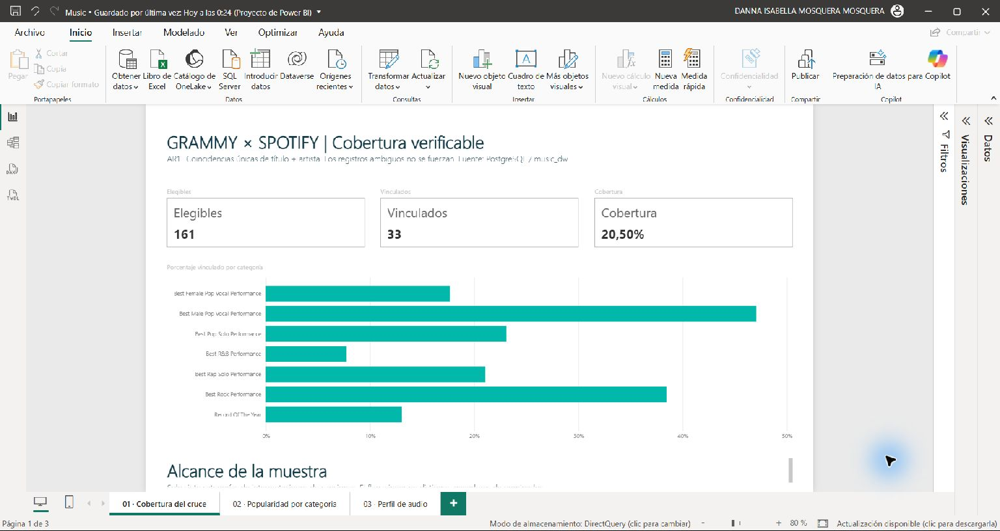
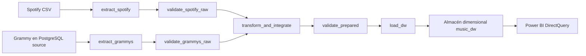
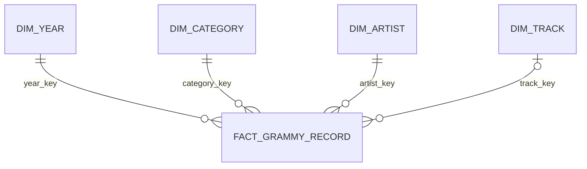

# Workshop 2 · Reliable Music Batch Pipeline

Proyecto académico de ingeniería de datos que integra registros de los premios Grammy con atributos musicales de Spotify. El flujo prepara y valida los datos, los transforma en un modelo dimensional de PostgreSQL y presenta tres preguntas analíticas en Power BI.

La solución usa Docker Compose, PostgreSQL 16, Apache Airflow 3.1.8, Great Expectations y Power BI Desktop. Airflow orquesta el proceso por lotes; Power BI consulta el almacén mediante DirectQuery.

## ¿Qué responde el análisis?

| ID | Pregunta | Indicador | Consulta analítica DW de referencia |
|---|---|---|---|
| AR1 · Cobertura | ¿Qué proporción de registros Grammy elegibles se vinculó inequívocamente con una canción de Spotify? | Canciones vinculadas / registros elegibles, además del detalle por categoría | `dw.kpi_coverage` |
| AR2 · Popularidad | ¿Cómo cambia la popularidad de las canciones vinculadas entre categorías Grammy? | Popularidad media por canción Spotify distinta dentro de cada categoría | `dw.kpi_popularity` |
| AR3 · Perfil de audio | ¿Cómo varían la energía y la bailabilidad según la década del registro Grammy? | Medias por canción Spotify distinta dentro de cada década | `dw.kpi_audio` |

Las categorías elegibles son una selección conservadora de premios a interpretaciones de canciones. El análisis no pretende cubrir todas las categorías Grammy ni afirmar quién ganó un premio.

## Resultado y estado de las verificaciones

- Los datos de entrada contienen 114.000 filas de Spotify y 4.810 registros Grammy.
- La integración produjo 161 registros elegibles: 33 vinculados, 115 sin coincidencia y 13 ambiguos. Los otros 4.649 registros quedan fuera del alcance analítico definido.
- La cobertura global observada es 20,50 %.
- Las pruebas A/B/C se ejecutaron con el scheduler de Airflow. A completó el flujo; B rechazó un valor inválido de popularidad sin alterar el almacén; C confirmó que repetir la carga con los mismos datos conserva el resultado.
- Las 10 pruebas automatizadas pasaron. Los resultados están en [`docs/evidence/tests.xml`](docs/evidence/tests.xml) y el resumen de escenarios en [`docs/evidence/reliability_summary.json`](docs/evidence/reliability_summary.json).
- Las definiciones del proyecto Power BI se validaron contra sus esquemas y la conexión local a PostgreSQL se comprobó en Power BI Desktop. La captura actual de AR1 aparece abajo; este README reserva espacio para incorporar las capturas de AR2 y AR3.

## Capturas de Power BI

### AR1 · Cobertura del cruce



### AR2 · Popularidad por categoría

<!-- Agregar aquí la captura de Power BI y guardarla como docs/evidence/powerbi_AR2.jpg. -->

*Espacio reservado para la captura de popularidad por categoría.*

### AR3 · Perfil de audio por década

<!-- Agregar aquí la captura de Power BI y guardarla como docs/evidence/powerbi_AR3.jpg. -->

*Espacio reservado para la captura de energía y bailabilidad por década.*

## Cómo funciona



El DAG `reliable_music_pipeline` contiene siete tareas. Las ramas Grammy y Spotify se validan por separado y deben pasar antes de la transformación. XCom transporta rutas y metadatos compactos; los archivos de trabajo se guardan por ejecución. Una regla crítica fallida bloquea las tareas posteriores.

La preparación inicial de Grammy carga el CSV original en una tabla de PostgreSQL. Esa preparación es independiente del ETL. El proceso de carga transforma los registros a un esquema estrella y reemplaza el snapshot en una transacción: si la operación falla antes del commit, el snapshot anterior permanece disponible.

### Modelo estrella de Power BI

El modelo semántico de Power BI consulta las tablas de hechos y dimensiones del almacén. `fact_grammy_record` queda al centro; cada dimensión filtra la tabla de hechos por una relación activa de muchos a uno. Las vistas `dw.kpi_*` se conservan como consultas de referencia y verificación en PostgreSQL, no como tablas desconectadas del modelo de Power BI.



Las claves sustitutas de relación se ocultan en el panel de campos para que el usuario del informe trabaje principalmente con nombres, categorías, décadas y medidas. El modelo completo está en [`powerbi/Music.SemanticModel/model.bim`](powerbi/Music.SemanticModel/model.bim).

### Criterios de integración y calidad

- Se normalizan título y artista para buscar coincidencias exactas; no se usa fuzzy matching.
- IDs de Spotify repetidos con atributos coherentes se consolidan. IDs con valores analíticos contradictorios se excluyen del cruce.
- Si hay más de una canción candidata para un registro Grammy, se marca como ambiguo y no se le asignan medidas.
- Las medidas faltantes permanecen nulas; cero no se usa como valor sustituto.
- Las reglas críticas de esquema, nulidad, dominio e integridad detienen el flujo. Los hallazgos definidos como advertencias quedan registrados y permiten continuar.
- AR2 y AR3 promedian canciones distintas dentro del grupo analizado para evitar contar varias veces la misma canción.

## Requisitos

- Windows 10/11 o un entorno compatible con Docker Desktop.
- Docker Desktop en modo Linux y Docker Compose v2.
- Al menos 4 GB de memoria disponibles para contenedores.
- Los archivos de entrada `spotify_dataset.csv` y `the_grammy_awards.csv`, obtenidos por el canal autorizado del curso.
- Power BI Desktop con soporte para proyectos PBIP/PBIR para abrir el informe.
- Python local solo es necesario para crear la configuración inicial; `scripts/init_env.py` usa la biblioteca estándar.

Los archivos de datos originales se mantienen fuera de Git y dentro de `sources/` en la copia local. No se deben subir al repositorio. El perfil y los SHA256 de referencia están en [`docs/evidence/profiling.json`](docs/evidence/profiling.json).

## Instalación y ejecución

Ejecuta los comandos siguientes desde la carpeta raíz del repositorio, en PowerShell.

### 1. Crear la configuración local

```powershell
python scripts/init_env.py
```

El script crea `.env` con credenciales locales aleatorias si ese archivo todavía no existe y prepara las carpetas de trabajo. No muestra las credenciales. Si `.env` ya existe, lo conserva.

Coloca los dos CSV originales en `sources/` con estos nombres exactos:

```text
sources/spotify_dataset.csv
sources/the_grammy_awards.csv
```

### 2. Construir e iniciar PostgreSQL

```powershell
docker compose build
docker compose up -d postgres
docker compose ps
```

Espera a que PostgreSQL aparezca como saludable. Después carga la fuente Grammy y crea la estructura del almacén:

```powershell
docker compose run --rm bootstrap
```

`bootstrap` compara el número de registros y el contenido importado. Al volver a ejecutarlo, reemplaza la tabla operacional Grammy de este entorno; no es la carga del ETL.

### 3. Iniciar Airflow

```powershell
docker compose up -d airflow
docker compose exec airflow airflow version
```

Abre [http://localhost:8080](http://localhost:8080) y busca el DAG `reliable_music_pipeline`. El usuario local es `admin`; la contraseña de desarrollo se guarda dentro del contenedor en `/opt/airflow/simple_auth_manager_passwords.json.generated`:

```powershell
docker compose exec airflow cat /opt/airflow/simple_auth_manager_passwords.json.generated
```

No compartas esa contraseña ni la guardes en Git. La primera carga de Airflow puede tardar alrededor de un minuto mientras se registran los DAGs.

### 4. Ejecutar las pruebas de fiabilidad y la suite automatizada

```powershell
docker compose exec airflow python scripts/run_reliability.py
docker compose exec airflow pytest -q tests --junitxml=docs/evidence/tests.xml
```

El primer comando dispara tres ejecuciones reales en el scheduler y conserva los estados de tareas, logs, resultados de calidad, snapshots del DW y consultas analíticas bajo `docs/evidence/`. La prueba de fallo trabaja sobre una copia de los datos para no alterar los archivos originales.

Para validar las definiciones JSON de Power BI:

```powershell
docker compose exec airflow python scripts/validate_powerbi.py
```

## Abrir y conectar Power BI

1. Confirma que Docker está activo y que el servicio PostgreSQL está saludable.
2. Abre `powerbi/Music.pbip` con Power BI Desktop.
3. Si solicita las credenciales de PostgreSQL, elige autenticación de base de datos e introduce:

   - Servidor: `localhost:5433`
   - Base de datos: `music_dw`
   - Usuario: el valor `POSTGRES_USER` de `.env` (por defecto, `music_admin`)
   - Contraseña: el valor `POSTGRES_PASSWORD` de `.env`

4. Selecciona **Conectar** y espera a que carguen las visualizaciones.

El informe tiene tres páginas: Cobertura, Popularidad por categoría y Perfil de audio por década. Power BI consulta las vistas `dw.kpi_coverage`, `dw.kpi_popularity` y `dw.kpi_audio`; no lee directamente los CSV. Las credenciales no se incluyen en el proyecto ni deben pegarse en este README.

La guía detallada del informe está en [`powerbi/README.md`](powerbi/README.md).

## Detener y reanudar

Para detener los servicios y conservar las bases de datos:

```powershell
docker compose stop
```

Para reanudarlos:

```powershell
docker compose up -d postgres airflow
```

Los volúmenes de Docker conservan las bases de datos y los metadatos de Airflow. No es necesario volver a importar Grammy después de cada reinicio.

## Estructura del repositorio

| Ruta | Contenido |
|---|---|
| `dags/` | DAG de Airflow y sus siete tareas |
| `src/` | Extracción, validación, transformación, carga y utilidades |
| `sql/` | Bases de datos, esquema estrella y vistas analíticas |
| `tests/` | Pruebas unitarias y de integración del proceso |
| `scripts/` | Inicialización de secretos, fiabilidad y validación Power BI |
| `sources/` | Entradas originales locales; excluidas de Git |
| `data/`, `logs/` | Datos de ejecución y logs locales; excluidos de Git |
| `powerbi/` | Proyecto PBIP/PBIR, modelo y guía del informe |
| `docs/` | Diseño, decisiones, trazabilidad y evidencias del proyecto |
| `notebooks/` | Notebook reproducible de perfilado de datos |

## Decisiones y limitaciones conocidas

- El campo `winner` aparece como verdadero en todos los registros Grammy disponibles y no permite distinguir ganadores; por eso el proyecto no calcula tasas de premios ganados.
- Spotify representa una instantánea sin fecha histórica fiable. Popularidad y atributos de audio describen los valores de esa fuente, no su evolución en el tiempo.
- La cobertura mide el cruce inequívoco dentro de las categorías elegibles definidas, no la cobertura de todo el catálogo Grammy.
- Las colaboraciones, versiones y diferencias de escritura pueden impedir una coincidencia exacta. Los casos dudosos se dejan sin vincular en lugar de adivinar.
- Las claves sustitutas del almacén pueden cambiar al reemplazar el snapshot. No se implementa historial SCD porque no hay snapshots fechados.

## Documentación y evidencias

- [Requisitos analíticos](docs/01_requirements.md)
- [Perfilado y riesgos](docs/02_profiling_and_risks.md)
- [Modelo dimensional](docs/03_dimensional_model.md)
- [Reglas de calidad](docs/04_quality_rules.md)
- [Transformación e integración](docs/05_transformation_integration.md)
- [Arquitectura y fiabilidad](docs/06_architecture_reliability.md)
- [Trazabilidad de extremo a extremo](docs/07_traceability.md)
- [Registro de evidencias](docs/08_evidence_register.md)
- [Guion de demostración](docs/09_defense.md)
- [Referencias técnicas](docs/10_references.md)

## Uso del repositorio

`.env`, las bases de datos, los logs, los datos de ejecución y los CSV originales están excluidos de Git. Antes de compartir cambios, revisa `git status` y confirma que no estás incluyendo contraseñas ni archivos de datos sujetos a restricciones de distribución.
