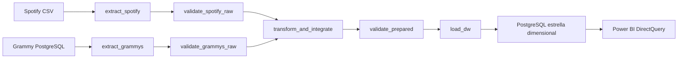

# Workshop 2 · Reliable Music Batch Pipeline

Sistema reproducible que integra Spotify CSV con Grammy Awards **extraído desde PostgreSQL**, valida datos con Great Expectations, orquesta siete tareas con **Apache Airflow 3.1.8** y carga una estrella dimensional consultada desde **Power BI**.

La especificación adjunta se titula *Workshop-2: Building a Reliable Batch Data Pipeline*. Aunque la solicitud menciona «proyecto 1», esta implementación sigue el documento adjunto. Todo el material de `sources/` es referencia de solo lectura.

## Resultado verificado

- 114.000 filas Spotify y 4.810 registros Grammy originales.
- Preparación Grammy reconciliada fila por fila con PostgreSQL.
- Prueba A: siete tareas correctas en el scheduler real.
- Prueba B: popularity=101 en copia aislada; S03 falla; transformación, validación preparada y carga quedan `upstream_failed`; el DW permanece intacto.
- Prueba C: reejecución con igual entrada conserva 4.810 hechos, las medidas y el hash de todas las filas de negocio.
- 10 pruebas automatizadas aprobadas, incluyendo rollback a mitad de carga y rechazo de preparado alterado; detalle en `docs/evidence/tests.xml`.
- Power BI: proyecto PBIP/PBIR con DirectQuery a `music_dw`, tres páginas y tres visualizaciones principales; definiciones validadas contra esquemas de Microsoft. La primera conexión requiere introducir las credenciales locales en Power BI Desktop. No confundir validación de esquema con comprobación visual de datos.

Estado detallado y evidencias: [registro de evidencias](docs/08_evidence_register.md).

## Objetivo y requisitos analíticos

| ID | Pregunta | KPI | Consulta DW |
|---|---|---|---|
| AR1 | ¿Qué cobertura tiene el cruce inequívoco por categoría de canciones? | vinculados / elegibles | dw.kpi_coverage |
| AR2 | ¿Cómo cambia la popularidad de las canciones vinculadas entre categorías? | Media por track_id distinto dentro de categoría | dw.kpi_popularity |
| AR3 | ¿Cómo varía el perfil de audio por década Grammy? | Energía y bailabilidad medias por canción distinta dentro de década | dw.kpi_audio |

El detalle de atributos, grano y necesidad de ambas fuentes está en [requisitos](docs/01_requirements.md).

## Puesta en marcha

Requisitos: Docker Desktop con contenedores Linux y Compose v2; al menos 4 GB de memoria disponibles para el entorno; Power BI Desktop compatible con PBIP/PBIR. Python local solo se usa para generar `.env` (biblioteca estándar).

1. Colocar los archivos originales `spotify_dataset.csv` y `the_grammy_awards.csv` en `sources/`. El paquete local entregado incluye copias de los originales. En GitHub están excluidos por defecto: distribuirlos por el canal autorizado del curso y verificar sus SHA256 en `docs/evidence/profiling.json`.
2. Crear secretos locales y carpetas:

```powershell
python scripts/init_env.py
```

3. Construir e iniciar PostgreSQL:

```powershell
docker compose build
docker compose up -d postgres
docker compose run --rm bootstrap
```

`bootstrap` crea la tabla operacional Grammy, carga el CSV con todos los valores text originales y verifica cantidad y contenido. Es preparación de fuente, **no** el Load del ETL. Si se ejecuta nuevamente reemplaza solo la fuente operacional del entorno de este proyecto. El DDL del DW se aplica sin eliminar hechos existentes.

4. Iniciar Airflow y verificar versión:

```powershell
docker compose up -d airflow
docker compose exec airflow airflow version
```

Abrir [Airflow local](http://localhost:8080). Usuario `admin`; la contraseña de desarrollo se genera en `/opt/airflow/simple_auth_manager_passwords.json.generated` dentro del contenedor. Consultarla localmente en Docker Desktop o con el siguiente comando, sin compartirla ni guardarla en Git:

```powershell
docker compose exec airflow cat /opt/airflow/simple_auth_manager_passwords.json.generated
```

Esperar a que el DAG `reliable_music_pipeline` aparezca. Las primeras importaciones de DAG pueden tardar un minuto. La infraestructura de este repositorio usa el nombre Compose `workshop2-music` y puertos de loopback 8080/5433.

5. Ejecutar las pruebas obligatorias (dispara DAGs mediante el scheduler, no simula sus estados):

```powershell
docker compose exec airflow python scripts/run_reliability.py
docker compose exec airflow pytest -q tests --junitxml=docs/evidence/tests.xml
```

El primer comando produce A/B/C, logs, suites GX, resultados por regla, reconciliación, comparación DW y consultas KPI. La carpeta de evidencia de cada escenario conserva la última demostración; las ejecuciones anteriores siguen en los metadatos Airflow y `data/runs/` mientras se mantenga el entorno.

6. Abrir `powerbi/Music.pbip` en Power BI Desktop. Conectar al servidor `localhost:5433`, base `music_dw`, autenticación de base de datos, usuario y contraseña de `.env`. La contraseña se introduce en la aplicación; el proyecto no la contiene. Ver [guía Power BI](powerbi/README.md).

7. Detener servicios conservando datos:

```powershell
docker compose stop
```

Para reanudar: `docker compose up -d postgres airflow`. No es necesario volver a importar Grammy después de cada inicio. Los volúmenes conservan metadatos y bases de datos.

## Arquitectura y tareas



TaskFlow se importa desde `airflow.sdk`. XCom contiene rutas y metadatos compactos. Los datasets permanecen en carpetas por run_id, compartidas con Docker. Las dependencias `all_success` bloquean transformación/carga ante fallos críticos.

## Perfilado, calidad y transformación

El [notebook ejecutado](notebooks/data_profiling.ipynb) lee Grammy desde PostgreSQL y Spotify desde CSV. Presenta estructura, nulos/blancos, duplicados, distribuciones, categorías, fechas y compatibilidad. `src/profile.py` produce el perfil original reproducible sin alterar fuentes.

Hallazgos: 22.259 repeticiones de track_id; 720 IDs con atributos analíticos contradictorios; 1 fila Spotify sin identidad completa; 1.840 artist Grammy ausentes y `winner=True` en las 4.810 filas. Por tanto, no se calculan tasas de ganadores ni se afirma quién ganó.

La transformación conserva un registro por Grammy, normaliza título/artista, colapsa repeticiones consistentes por track_id y pone en cuarentena los conflictos. No usa fuzzy matching. Con más de un ID candidato, el registro es ambiguo y no aporta medidas. Resultado observado: 161 elegibles, 33 matched, 115 unmatched, 13 ambiguous y 4.649 out_of_scope. Cobertura global: 20,50%.

Véanse [riesgos](docs/02_profiling_and_risks.md), [reglas GX](docs/04_quality_rules.md) y [contrato de integración](docs/05_transformation_integration.md).

## Validación automatizada

Cada capa tiene activo pandas, BatchDefinition, ExpectationSuite y ValidationDefinition independientes. `ValidationDefinition.run` constituye la ejecución controlada: persiste JSON completo, suite y política antes de bloquear o aceptar. Las reglas llevan `meta.rule_id` y severidad.

Las advertencias esperadas (duplicados por género, artistas ausentes, winner constante y cobertura incompleta) se conservan y no detienen el lote. Las reglas críticas de esquema, nulidad, dominio, unicidad e integridad sí lo detienen. El Load exige además el SHA256 aceptado del archivo preparado, evitando cargar un archivo modificado después del gate.

## Modelo dimensional y carga

Grano: un hecho por registro Grammy original identificado por ordinal `source_row_id`. Dimensiones: año/década, categoría, crédito de artista y canción Spotify. Hay PK, FKs, business keys UNIQUE y restricciones de dominios. Las medidas faltantes se conservan NULL; cero sigue significando cero.

La carga reemplaza el snapshot dentro de una transacción con advisory lock y auditoría. Si falla antes del commit se conserva el snapshot previo. AR2/3 deduplican canciones dentro del grupo antes de promediar. [Modelo](docs/03_dimensional_model.md), [DDL](sql/dw_schema.sql).

## Fallos, reintentos y observabilidad

Extracción PostgreSQL y carga: dos reintentos con espera inicial de 20 segundos y backoff para errores transitorios. Validación, transformación y lectura local: cero reintentos. Los errores deterministas disparan `AirflowFailException` y no consumen reintentos de conexión. Logs incluyen run_id, cantidades, resultado de calidad y causa del fallo.

La prueba B modifica una copia del raw Spotify con `inject_raw_failure=true`; los originales no cambian. El fallo se vincula a S03 y su resultado GX. La reejecución compara conteos, sumas de control y SHA256 de todos los hechos con claves naturales. [Política completa](docs/06_architecture_reliability.md).

## Documentación y defensa

- [Trazabilidad de extremo a extremo](docs/07_traceability.md).
- [Registro de evidencias y pendientes](docs/08_evidence_register.md).
- [Guion de demostración y defensa](docs/09_defense.md).
- [Referencias técnicas oficiales](docs/10_references.md).

## Limitaciones

La cobertura conservadora no representa todo el catálogo Grammy. `winner` carece de discriminación y no es una verdad verificada de premios. Spotify no aporta fecha de snapshot: popularidad/audio no son históricos. Los créditos colaborativos y versiones distintas pueden no coincidir. Las claves sustitutas cambian con el reemplazo de snapshot; no se publica un historial SCD.

Power BI requiere la primera autenticación local y verificar las tres páginas renderizadas. La captura de Graph/Grid de Airflow requiere iniciar sesión en su UI. El repositorio está preparado para GitHub; la publicación requiere un repositorio de destino y acceso autorizado. Los pendientes reales se mantienen explícitos en el registro de evidencias.
