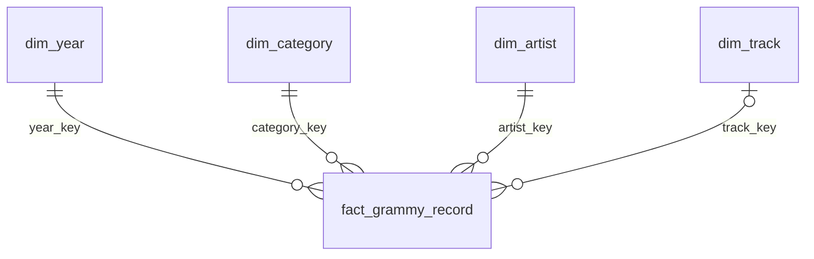

# Modelo dimensional

Proceso: presencia de un registro Grammy en el catálogo proporcionado y su vinculación conservadora con una canción de la instantánea Spotify.

Grano: **una fila de fact_grammy_record por source_row_id de Grammy**, incluyendo los registros fuera de alcance y no vinculados. No es una fila por ganador ni por artista. La fila original se conserva aunque tenga contenido repetido; el identificador de registro permite trazabilidad.

| Tabla | Clave | Contenido |
|---|---|---|
| dim_year | year_key natural | Año original y década |
| dim_category | category_key sustituta; category_name UNIQUE | Categoría Grammy original |
| dim_artist | artist_key sustituta; artist_name UNIQUE | Crédito Grammy; [missing] para ausencia |
| dim_track | track_key sustituta; track_id UNIQUE | ID Spotify, título y crédito Spotify |
| fact_grammy_record | source_row_id PK; FKs a cuatro dimensiones | nominee, elegibilidad, estado, candidatos, popularidad, energía, bailabilidad |

La FK track_key es nula cuando no hay coincidencia inequívoca: no se crea una canción ficticia con métricas cero. Las tres medidas son no aditivas; se promedian sobre canciones distintas por categoría/década. Sumar popularidad no es un KPI; su suma solo se usa como control de reejecución.

Las claves sustitutas se regeneran en el reemplazo atómico de la instantánea. No se ofrecen referencias externas estables a esas claves; los identificadores naturales se preservan. No se implementa SCD2 porque no existe historial de snapshots ni fecha de observación fiable. load_audit conserva historial técnico de cargas.

DDL y restricciones ejecutables: `sql/dw_schema.sql`. AR1 usa estado/elegibilidad/categoría; AR2 usa track_id/popularity/categoría; AR3 usa track_id/energy/danceability/década.
