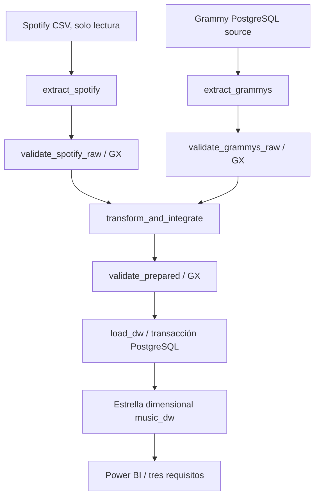

# Arquitectura, operación y fiabilidad

Preparación separada: CSV Grammy → bootstrap → tabla source. No forma parte de la carga ETL. Se compara cada valor y cantidad con el CSV; se conserva el hash. Los campos se guardan text para no ocultar defectos mediante conversiones de importación; source_row_id es ordinal de registro CSV, no número de línea física.

Airflow 3.1.8 TaskFlow usa `from airflow.sdk import dag, task`. Siete tareas, `all_success` por defecto y dos ramas convergentes. XCom transporta rutas y resumen de carga, nunca el dataset. Cada run_id tiene carpeta aislada por hash. `max_active_runs=1` y advisory lock PostgreSQL impiden escrituras de snapshots concurrentes. Airflow standalone inicia scheduler, dag processor y API para este entorno académico; metadatos en PostgreSQL y LocalExecutor, sin SQLite. No es una topología de alta disponibilidad.

| Condición | Acción | Reintentos | Razón |
|---|---|---|---|
| Lectura Spotify local, archivo ausente | Fail-fast | 0 | Repetir no repara archivo faltante |
| Extracción DB: caída de conexión | Fallo visible y reintento | 2, 20 s, backoff | Posible fallo transitorio |
| GX Critical o error de ejecución de validación | Fallar gate, bloquear descendientes | 0 | Entrada/contrato determinista |
| GX Warning | Guardar evidencia y continuar | 0 | Política explícita por regla |
| Transformación | Fallar con contexto | 0 | Error determinista |
| Carga: conexión perdida / bloqueo transitorio | Rollback y reintento | 2, 20 s, backoff | Transacción + reemplazo idempotente |
| Carga: contrato/aceptación inválida | AirflowFailException | 0 efectivos | No se soluciona repitiendo |

Errores SQL de integridad/programación se clasifican como deterministas antes de propagar a Airflow. Los reintentos operacionales se reservan para errores de conexión/transacción recuperables.

Estrategia de reejecución: `TRUNCATE` de hechos y dimensiones + inserción + controles + auditoría en una sola transacción. Una caída anterior al commit deja el snapshot previo. Un commit confirmado cuya respuesta se pierde puede repetirse con el mismo resultado de negocio. La auditoría por run_id usa upsert. Claves naturales UNIQUE y FKs impiden multiplicidades accidentales. Los consumidores concurrentes pueden esperar por el bloqueo transaccional; después observan un snapshot íntegro.

Prueba A: ejecución programada real, siete tareas success. Prueba B: copia raw aislada con popularity=101; S03 falla, tres tareas descendientes upstream_failed y DW sin cambios. Prueba C: mismos archivos fuente, nuevo run_id, igualdad de filas, medidas y hash de todos los hechos con sus claves de negocio.

Evidencia: `scripts/run_reliability.py` dispara DAGs reales y consulta estados de la base de metadatos. Conserva timestamps, try_number, logs y GX JSON por ejecución. El hash no incluye load_audit, cuyo timestamp cambia intencionalmente.
