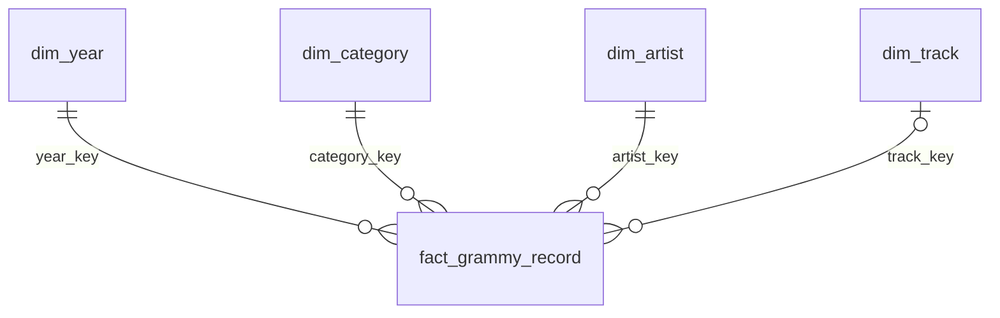

# Power BI · Music

El proyecto `Music.pbip` usa DirectQuery a PostgreSQL y expone en el modelo semántico las tablas físicas del almacén dimensional. En la vista **Modelo**, el usuario debe ver `fact_grammy_record` al centro y las cuatro dimensiones conectadas alrededor. Las relaciones son activas, de muchos a uno y con filtro en una sola dirección desde cada dimensión hacia la tabla de hechos.



| Rol | Tabla | Campos de negocio principales |
|---|---|---|
| Hechos · centro | `dw.fact_grammy_record` | `source_row_id`, `nominee`, `eligible`, `match_status`, `candidate_count`, `popularity`, `energy`, `danceability` |
| Dimensión | `dw.dim_year` | `year_key`, `decade` |
| Dimensión | `dw.dim_category` | `category_name` |
| Dimensión | `dw.dim_artist` | `artist_name` |
| Dimensión | `dw.dim_track` | `track_id`, `track_name`, `spotify_artists` |

Las claves sustitutas usadas para unir tablas se ocultan en el panel de campos para que el informe muestre principalmente los atributos analíticos. La clave `track_key` es opcional en la tabla de hechos porque los registros no vinculados no tienen una canción Spotify asignada.

## Conexión

Abre `Music.pbip` en Power BI Desktop. Si aparece el diálogo de credenciales, elige autenticación de base de datos e introduce:

- Servidor: `localhost:5433`
- Base: `music_dw`
- Usuario: `POSTGRES_USER` en `.env` (por defecto, `music_admin`)
- Contraseña: `POSTGRES_PASSWORD` en `.env`

PostgreSQL debe estar activo en Docker Desktop. No guardes la contraseña en los archivos del modelo ni en GitHub. El archivo [`connection.pbids`](connection.pbids) contiene la dirección local de conexión, no las credenciales.

## Páginas y medidas

| Página | Dimensión para agrupar | Medidas de `fact_grammy_record` | Visuales |
|---|---|---|---|
| 01 · Cobertura | `dim_category[category_name]` | `Elegibles`, `Vinculados`, `Cobertura` | Tres tarjetas y barras por categoría |
| 02 · Popularidad | `dim_category[category_name]` | `Popularidad media`, `Canciones por categoria` | Barras y tabla de tamaño muestral |
| 03 · Audio | `dim_year[decade]` | `Energia media`, `Bailabilidad media`, `Canciones por decada` | Dispersión y tabla por década |

Las medidas AR2 y AR3 iteran sobre canciones distintas dentro del filtro de categoría o década. Los promedios de esos grupos no se vuelven a promediar en el total, porque tienen denominadores diferentes. AR1 calcula la razón entre vinculados y elegibles.

Valores de referencia verificados en PostgreSQL: 161 elegibles, 33 vinculados y 20,50 % de cobertura. En `Best Pop Solo Performance`: tres canciones distintas y popularidad media 83,67. Para la década de 2010: 12 canciones distintas, energía media 0,6748 y bailabilidad media 0,6104. Los resultados reproducibles están en [`docs/evidence/dw_analytics.json`](../docs/evidence/dw_analytics.json).

## Actualizar o validar el modelo

El generador fuente del proyecto está en `scripts/build_powerbi.py`. Ejecutarlo vuelve a generar el modelo y las páginas del informe; conserva las credenciales fuera del proyecto. Valida la estructura estrella y las definiciones PBIR con:

```powershell
docker compose exec airflow python scripts/validate_powerbi.py
```

La evidencia se guarda en `docs/evidence/powerbi_schema_validation.json`, incluyendo las cuatro relaciones de la estrella.
